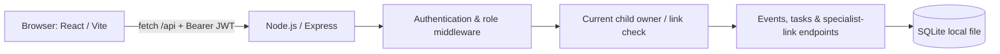

# v0.1 design overview



The application is a local **layered monolith**, not cloud-deployed and not Dockerized. The backend exposes one API; the frontend uses a Vite development proxy. SQLite uses Node 22's built-in `node:sqlite` `DatabaseSync` API (experimental warning may be printed by Node 22). No native SQLite npm add-on is required.

## Data model

```mermaid
erDiagram
 USERS ||--o| CHILDREN : "child account"
 USERS ||--o{ CHILDREN : "parent owner"
 USERS ||--o{ SPECIALIST_LINKS : "registered specialist"
 CHILDREN ||--o{ SPECIALIST_LINKS : "authorized relationships"
 CHILDREN ||--o{ EVENTS : "has events"
 CHILDREN ||--o{ TASKS : "has tasks"
 USERS ||--o{ EVENTS : "created by"
 USERS ||--o{ TASKS : "assigned by"
 USERS { int id PK; string email; string role; string password_hash; string display_name; }
 CHILDREN { int id PK; int user_id FK; int parent_user_id FK; string display_name; }
 SPECIALIST_LINKS { int child_id PK; int specialist_user_id PK; string specialist_type; }
 EVENTS { int id PK; int child_id FK; int created_by_user_id FK; string starts_at; string ends_at; string title; }
 TASKS { int id PK; int child_id FK; int assigned_by_user_id FK; string due_at; string status; string development_area; }
```

IDs are SQLite integers. Passwords are salted `scrypt` hashes with 16 random salt bytes. An HS256 JWT expires after eight hours and contains only the user ID as `sub`. `JWT_SECRET` is loaded from a local, ignored `.env` file; never commit it. Authorization is enforced in Express routes and never relies on hidden frontend controls.

## Key design choices

- For v0.1, each child belongs to exactly one parent and exactly one child account. Multiple specialists can be linked per child; they may also be linked to multiple children. This is a proposed modeling choice in the SRS/SDD.
- New events and tasks are visible to parent and **all linked specialists** for the selected child; the child can see only their own schedule and tasks. Specialist links are not cached in JWTs, so unlinking takes effect immediately.
- Week navigation is Monday–Sunday in **UTC** (a proposed decision). Timestamps use ISO 8601 instants, while task due dates use calendar `YYYY-MM-DD` strings.
- No M5–M8 endpoints are included because they belong to release v0.2; no invitations, admin, monthly view, document uploads or AI provider were added early.
- This is a **classroom prototype, not a production child-data service**. No real personal information or sensitive clinical records may be entered. Browser `localStorage` is used for its simple demo login; a production system would require a threat-model-driven session design and comprehensive hardening.

## Module map

- `server/src/db.js` schema and SQLite connection.
- `server/src/security.js` password hashing and JWT helpers.
- `server/src/authorization.js` request authentication and child-scoped authorization.
- `server/src/validation.js` area/type/field/date validation.
- `server/src/app.js` REST endpoint controllers and error handling.
- `server/src/fixtures.js`, `seed.js` fictional fixture data.
- `client/src/lib/auth.jsx` session restoration and role selection.
- `client/src/pages/Workspace.jsx`, `ChildHome.jsx`, `Login.jsx` main role screens.
- `client/src/components/` events, tasks, links and layout.
- `server/tests/`, `client/tests/`, `e2e/` testing layers.

## Endpoint permissions

| Operation | Owning parent | Currently linked specialist | Child owner | Other users |
|---|---|---|---|---|
| List / create events | Read + create | Read + create | Read only | No |
| List / create tasks | Read + create | Read + create | Read only | No |
| Mark task completed | No | No | Yes (own child) | No |
| List, link, unlink specialists | Yes | No | No | No |
| List children | Own only | Linked only | No (`/child/me` instead) | No |

More precise endpoint-level documentation is in [API.md](API.md).
